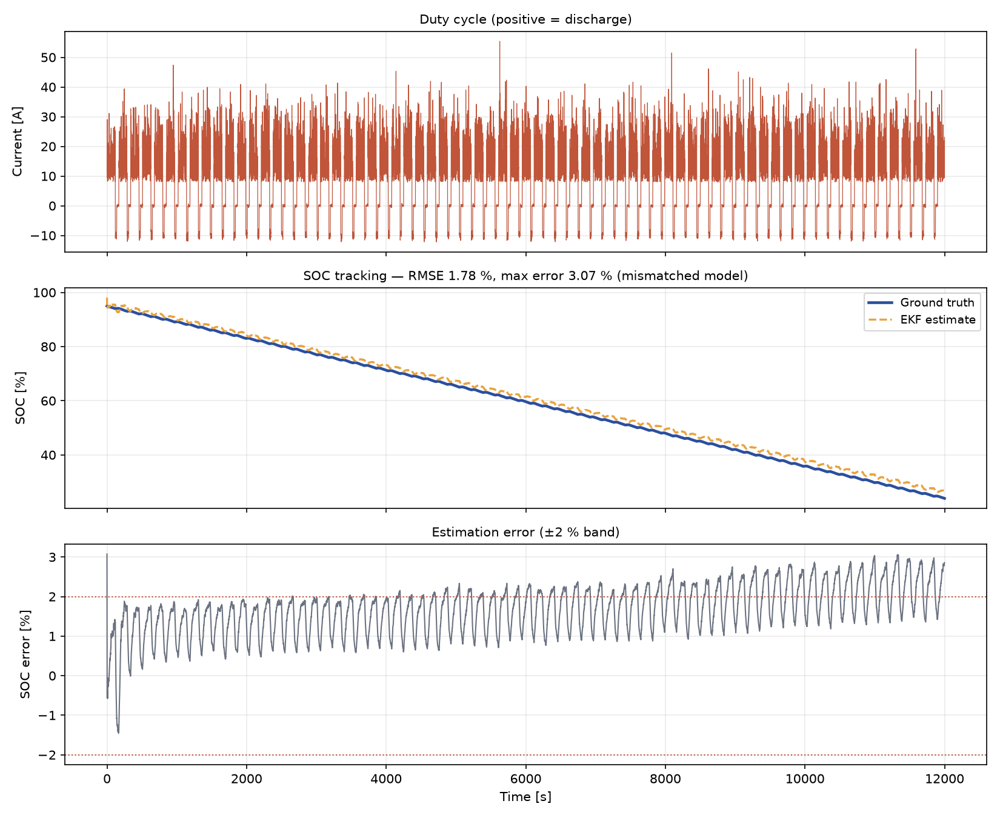
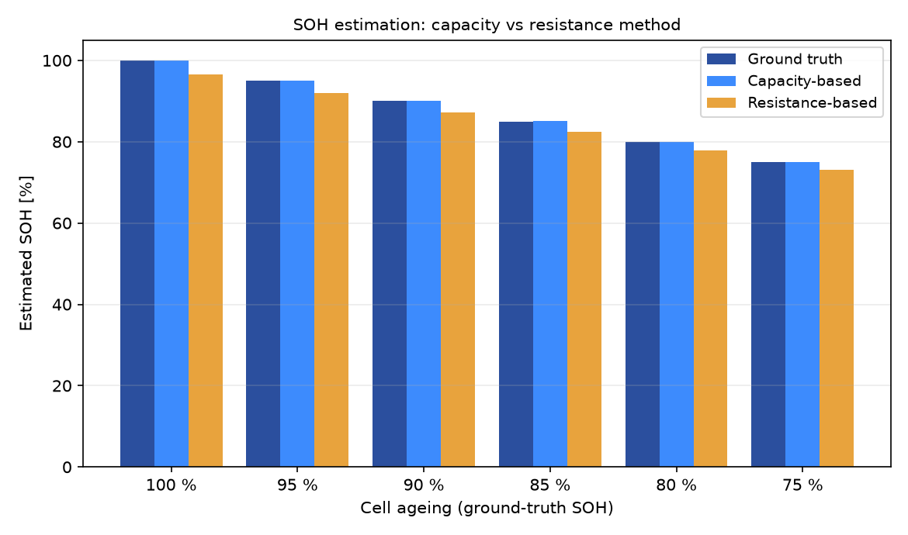

# Battery SOC & SOH Estimation — 2-RC Model + Extended Kalman Filter

State-of-Charge and State-of-Health estimation for lithium-ion cells, implemented
from first principles in plain Python (NumPy only for the algorithms).

This is the kind of model-based estimation that runs in production BMS firmware,
built here as a self-contained, reproducible simulation.



---

## Results at a glance

| Metric | Value | Conditions |
|--------|-------|-----------|
| **SOC RMSE** | **1.79 %** | mismatched model¹, 5 mV voltage noise, 50 mA current noise |
| SOC max error | 3.07 % | worst pulse transient |
| SOC convergence | from a **25 % initial error** | filter started deliberately wrong |
| **SOH — capacity method** | **< 1 % error** | across 100 % → 75 % SOH |
| SOH — resistance method | correct monotonic trend, ≈ 3.5 % bias² | 1 Hz sampling |

¹ *Mismatched model*: the EKF runs on parameters identified "offline" that are
2–5 % off the plant (capacity, R0, both RC branches), plus sensor noise. Running
the filter on the exact plant would show a meaningless ~0.02 % RMSE — not what
happens on a real pack.

² The bias is a **sampling-rate limit**, not a coding error — see
[Engineering findings](#engineering-findings).

| SOH estimation | |
|---|---|
|  | |

---

## Method

### 1. Battery model — second-order RC equivalent circuit

```
SOC(k+1) = SOC(k) − η·I·Δt / (3600·Q)
V1(k+1)  = a1·V1(k) + R1(1−a1)·I        a1 = exp(−Δt/(R1C1))
V2(k+1)  = a2·V2(k) + R2(1−a2)·I        a2 = exp(−Δt/(R2C2))
V(k)     = OCV(SOC) − I·R0 − V1 − V2
```

The two RC branches model fast (charge-transfer, ~tens of seconds) and slow
(diffusion, ~minutes) polarization. `OCV(SOC)` is a monotonic polynomial
(3.0 V → 4.2 V), with the analytic derivative used for the measurement Jacobian.

### 2. SOC estimation — Extended Kalman Filter

State `x = [SOC, V1, V2]ᵀ`, measurement `y = V_terminal`. The nonlinear OCV
term is linearised at every step:

```
H = [dOCV/dSOC, −1, −1]
```

Predict/update with the standard Joseph-form-avoiding covariance update. The
covariance design (`P0`, `Q`, `R`) follows sensor reality: `R` = (5 mV)² for a
realistic voltage channel.

### 3. SOH estimation — two independent methods

* **Capacity-based** — Ah-throughput over an SOC window: `Q = ∫I dt / ΔSOC`.
  Restricted to SOC ∈ [0.20, 0.90] where ΔSOC is well conditioned.
* **Resistance-based** — ohmic resistance from current steps,
  `SOH ≈ R_nominal / R_measured`, using the **median over the 20 strongest
  transients** to suppress noise.

---

## Engineering findings

These are the non-obvious issues that came up while building this, and how they
were resolved. They are the reason the numbers above are credible.

**1. Model mismatch shows up as a *steady-state bias*, not noise.**
An R0 error of *e* under current *I* shifts the predicted voltage by *e·I*,
which the filter interprets as an SOC shift: `ΔSOC ≈ e·I / (dOCV/dSOC)`.
With a 15 % R0 error at 20 A and dOCV/dSOC ≈ 1 V per unit SOC, that is a ~6 %
SOC bias — with *no* increase in noise. Fix: realistic identification accuracy
(2–5 %) **or** online parameter identification.

**2. P0 must match the actual initial uncertainty.**
Setting `P0` too small makes the filter over-confident: it trusts its wrong
initial SOC and refuses correction for a long time. Setting it absurdly large
makes SOC snap to truth in a single step, which is not physical. A prior
standard deviation of ~20 % (we start 25 % off) behaves correctly.

**3. SOC is only observable where the OCV curve has slope.**
Near 100 % and near 0 % the OCV plateau flattens, so voltage carries almost no
SOC information and the estimate drifts freely. The duty cycle here is
deliberately kept inside the observable window — a real BMS uses the same
argument when defining its operating SOC range.

**4. At 1 Hz sampling, ohmic and RC responses partially alias.**
The resistance method inherits a small part of the RC overpotential, biasing R0
high and hence SOH low by ~3.5 %. Production BMS estimates R0 from
millisecond-scale transients or identifies all parameters jointly. This is left
visible rather than tuned away, because the limitation is real.

---

## Quick start

```bash
python -m venv .venv && source .venv/bin/activate     # or: uv venv .venv
pip install -r requirements.txt
python simulate.py
```

Outputs land in `results/`:

```
results/soc_estimation.png     SOC tracking, error band, duty cycle
results/soh_estimation.png     SOH: capacity vs resistance method
results/metrics.txt            numeric summary
```

`diag_ekf.py` runs a noise-free, exactly-initialised sanity check — it must
return a ~0.000 % error, which validates the filter implementation before
trusting any noisy result.

---

## Project structure

```
soc-soh-estimation/
├── simulate.py            # entry point: runs both studies, writes figures
├── diag_ekf.py            # ideal-case sanity check for the EKF implementation
├── src/
│   ├── battery_model.py   # 2-RC ECM + OCV(SOC)
│   ├── ekf.py             # EKF state estimator
│   ├── data_generator.py  # duty cycle + sensor noise + ageing model
│   └── soh.py             # capacity-based and resistance-based SOH
└── results/               # generated figures and metrics
```

---

## Limitations & next steps

* **Online parameter identification** (recursive least squares or dual EKF) to
  remove the model-mismatch bias without manual tuning.
* **Temperature dependence** — R0 and capacity are strong functions of
  temperature; a production model is parameterised over a temperature grid.
* **Higher-rate sampling** for the resistance method, or joint estimation of
  R0 and the RC branches.
* **Data-driven comparison** — an LSTM/GRU baseline on the same profile, to
  quantify where model-based estimation still wins.

---

*Built by a BMS software engineer as a self-contained study of model-based
state estimation. MIT licensed.*
